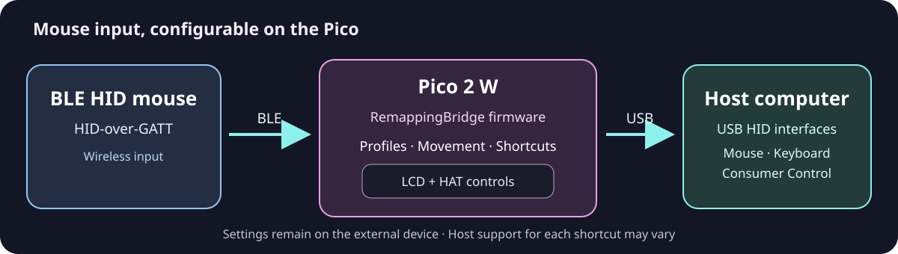

# RemappingBridge

**Make your Bluetooth mouse work your way — on a pocket-sized device.**

No special RemappingBridge software to install on a compatible computer. Pair a BLE mouse with the **Raspberry Pi Pico 2 W (RP2350)**, choose button actions and pointer behavior using the little LCD, and send standard USB HID input to the host.

### Try it. Get it.

[**▶ OPEN THE LIVE SIMULATOR**](https://remappingbridge.github.io/) &nbsp; | &nbsp; [**⬇ DOWNLOAD FIRMWARE v3.2.4 (.UF2)**](https://github.com/remappingbridge/remappingbridge/releases/download/v3.2.4/remappingbridge-v3.2.4-pico2w.uf2)

[All releases / latest version](https://github.com/remappingbridge/remappingbridge/releases/latest) · [SHA-256 checksums for v3.2.4](https://github.com/remappingbridge/remappingbridge/releases/download/v3.2.4/SHA256SUMS.txt) · [Quick compatibility notes](#what-you-need-to-know-about-compatibility)

### Two small boards. Lots of possibilities.

<p align="center">
  <a href="https://www.raspberrypi.com/news/raspberry-pi-pico-2-w-on-sale-now/"></a>
  &nbsp;
  <a href="https://www.waveshare.com/Pico-LCD-1.3.htm"></a>
</p>

<p align="center">
  <strong><a href="https://www.raspberrypi.com/news/raspberry-pi-pico-2-w-on-sale-now/">Raspberry Pi Pico 2 W (RP2350)</a></strong> &nbsp; · &nbsp;
  <strong><a href="https://www.waveshare.com/Pico-LCD-1.3.htm">Waveshare Pico-LCD-1.3 (SKU 19650)</a></strong>
</p>

<sub>Hardware photos are displayed from the Raspberry Pi and Welectron websites and linked to the corresponding manufacturer product information; they are not photographs of a finished RemappingBridge assembly. The RP2350 is the chip inside the Pico 2 W board. The Pico-LCD-1.3 is the Pico accessory with joystick and four buttons, <strong>not</strong> the 40-pin Raspberry Pi LCD HAT.</sub>

### What can you do?

- **Make a mouse button your shortcut key.** Use one Modifier button for **12 combinations** and choose from **30 keyboard and media actions**.
- **Make movement feel right.** Adjust horizontal and vertical speed separately, or rotate pointer movement by 90°, 180° or 270°.
- **Keep settings with your mouse.** Save individual profiles on the device, then use them with a compatible USB host without installing this project's desktop app.

---

## Why use it?

Mouse customization is often tied to a particular computer or installed utility. RemappingBridge lets you configure supported mouse behavior on a small external device and use it with another USB HID-capable host without installing a dedicated RemappingBridge application there.

- **Everyday productivity:** assign actions such as Copy, Paste, Undo, Save, Search or media controls to supported mouse combinations instead of reaching for the keyboard each time.
- **Personalized input and accessibility:** experiment with button assignments and independent horizontal/vertical pointer gain to find a more comfortable control arrangement. These are customization options, **not a guarantee of accessibility for every person, mouse or application**.
- **Different workstations:** carry saved mouse-specific settings on the Pico rather than relying on this project's utility being installed on each computer. The host still has to support the USB HID usages and any keyboard shortcuts selected.

## How it works

### The signal path



**BLE HID mouse → Pico 2 W + LCD controls → USB HID → computer.**

1. **Bluetooth input:** a compatible BLE HID-over-GATT (HOGP) mouse pairs with the **Pico 2 W**, not with the computer's Bluetooth adapter.
2. **On-device configuration:** the firmware applies the connected mouse's saved profile, custom button behavior, movement scaling/rotation and optional Modifier Shortcuts. The attached LCD and joystick/buttons provide the user interface.
3. **USB output:** the Pico presents USB HID mouse, keyboard and consumer-control interfaces to the computer. RemappingBridge does not need a dedicated desktop driver or application on a host that supports these standard interfaces.

The USB cable carries HID input **to** the host. The firmware does not browse the host's files, read application state or automatically know which application is focused.

## Features in current firmware

- **Two mapping profiles — Passthrough and Custom.** Passthrough keeps ordinary mouse button behavior. Custom maps the five mouse buttons (Left, Right, Middle, Forward and Backward), including the option to designate **one** as a Modifier.
- **Modifier Shortcuts:** up to **12 combinations** involving Modifier release, other buttons, wheel scrolling and pointer movement; select among **30 keyboard/media actions**. The Modifier's own button combination is unavailable rather than treated as another ordinary click.
- **Movement Options:** independently set horizontal and vertical movement scaling from **0.25× to 3×** and rotate pointer motion by **0°, 90°, 180° or 270°**.
- **Saved Devices:** pair, reconnect, inspect and remove saved mice, with applied remapping, shortcuts and movement settings associated with individual mouse identities.
- **On-device interface:** a 240 × 240 LCD with a 9-line × 21-character layout, joystick and A/B/X/Y controls; Help, navigation, selection markers and LCD Lock.

### Examples to explore

**Assign Copy to a combination.** Configure one supported mouse button as **Modifier**, then choose a combination and the **COPY** action. Whether the shortcut performs Copy depends on the receiving application.

**Change pointer movement.** Set horizontal gain to **2×** and vertical gain to **0.75×**, or select a 90° rotation, without changing the host's mouse preferences through this project's software.

**Keep two mouse setups separate.** Save different Custom/Movement settings for different BLE mice, then reconnect the mouse whose settings you want to use.

These are descriptions of current firmware capabilities; they are not claims that every mouse, application or host has been tested.

## Try it in your browser

Open the **[RemappingBridge interactive simulator](https://remappingbridge.github.io/)** to explore the LCD and nine HAT controls before assembling hardware. The live application opens on GitHub Pages; it does **not** run inside the README.

### Five-minute guided demo: HOME → Movement → Modifier

1. **Explore HOME without saving a mouse.** Select **Home Connected** under **Choose a demo state**. The LCD shows the connected HOME structure. This is an isolated visual preview and does not pair anything.
2. **Create a virtual mouse to edit its settings.** In **Virtual Mouse Lab**, enter a name in **New virtual mouse name**, click **Start Pair New**, then **Complete Successfully** in the pairing card. Select **Home Connected** again if needed. These virtual records belong to this browser only.
3. **Try Movement.** On the virtual LCD, focus **MOVEMENT OPTIONS** using the HAT joystick **UP/DOWN** (or keyboard arrows); press the joystick inward (**JOY PRESS**, or Enter). Explore the horizontal/vertical movement gains and rotation; select a value and use **KEY A** to apply it. **KEY B** normally goes back. If a real connected virtual mouse is not selected, the app will not persist changes.
4. **Set a Modifier.** From HOME choose **REMAPPING OPTIONS → CUSTOM REMAPPING**, then the Custom editor and a physical mouse-button source. In its **WILL BECOME** selector, choose **MODIFIER** and apply the target; then **APPLY CUSTOM** to commit the whole Custom profile. A Modifier becomes active only when the **applied** profile is Custom.
5. **Assign a shortcut.** Return to **REMAPPING OPTIONS → MODIFIER SHORTCUTS**, choose a **COMBINATIONS** slot and one of the **30 SHORTCUTS**, then press **KEY A: APPLY AND BACK**. Try returning to HOME. In the browser, this only saves a simulated shortcut; it does **not** send Ctrl/C/V, media keys or any other HID signal to your host.

**Navigation cheatsheet:** joystick directions move the selection, **JOY PRESS** opens, **KEY A** applies where offered, **KEY B** returns/cancels on most pages, **KEY X** displays Help where available and **KEY Y** controls LCD Lock. Some screens deliberately have different hints; follow the text shown on the virtual LCD.

The single-page simulator includes **45 canonical firmware screens**, the three visual demo states (*Searching First Mouse*, *First Mouse Connected*, *Home Connected*), a **Virtual Mouse Lab** for local simulated pairing, saved-device profiles and failures, and an optional diagnostic Inspector. Its [browser test page](https://remappingbridge.github.io/tests/) uses separate temporary test data.

**Important:** the website is a simulation. It does **not** connect to a real Bluetooth mouse, control a physical Pico, send HID shortcuts to your computer or install firmware. Mouse names and profiles created in the main Virtual Mouse Lab are local browser data, not physical Pico records. GitHub README pages cannot embed the live JavaScript application; use the link above.

## Hardware and safe assembly

The project uses two separate boards: the **Raspberry Pi Pico 2 W**, which runs the firmware and receives Bluetooth mouse input, and the **Waveshare Pico-LCD-1.3**, which provides the screen and nine physical controls. The RP2350 is the **microcontroller chip on the Pico 2 W**, not a standalone replacement board.

### What to get

| Item | Needed? | What to check |
| --- | --- | --- |
| [Raspberry Pi Pico **2 W**](https://www.raspberrypi.com/products/raspberry-pi-pico-2/) | **Required** | RP2350 board with on-board Bluetooth LE; the non-wireless Pico 2 does **not** replace it. |
| [Waveshare **Pico-LCD-1.3**](https://www.waveshare.com/Pico-LCD-1.3.htm) | **Required** | **SKU 19650**, 1.3-inch IPS, **240 × 240** pixels, **ST7789 over SPI**, joystick and **four A/B/X/Y buttons**, with its Pico-style female headers. The Pico is not included with the LCD. |
| Compatible BLE HID mouse | **Required** | Bluetooth Low Energy **HID-over-GATT (HOGP)**; USB receiver-only and Bluetooth Classic-only mice are not interchangeable. |
| **Micro-USB data cable** | **Required** | Fits the Pico 2 W's Micro-USB port and reaches a USB HID-capable computer; a charge-only cable is insufficient. |
| **Two 20-pin male header strips**, if not already fitted | **Conditional** | Needed for an unpopulated Pico 2 W to mate with the LCD module's female sockets; choose a correctly assembled/pre-soldered Pico if you do not solder. |
| Insulating base, case or spacers | Optional | Protect exposed contacts and avoid shorts; leave the Pico wireless antenna clear of metal. |

**Important:** buy the **Pico-LCD-1.3 for Pico**, not the similarly named **1.3inch LCD HAT for a full-size Raspberry Pi with a 40-pin GPIO connector**. Both the physical layout and software target are different.

### What the two boards look like together


[Open the assembly illustration at full size](docs/assets/pico-2w-lcd-assembly.svg). This is an **original explanatory drawing**, not a scale drawing, hardware photograph, PCB electrical schematic or substitute for the manufacturers' pin-1 markings. The real hardware photographs remain at the top of this README.

### Connect the boards safely

1. **Disconnect power** from the Pico 2 W and remove the USB cable before touching the headers. Put both boards on a clean, nonconductive surface.
2. **Check the Pico's pins.** The LCD has female sockets; the Pico needs two **straight, correctly fitted 20-pin male headers**. If your Pico has bare plated holes, use a pre-soldered board or have the headers fitted correctly; **do not press bare holes onto the LCD sockets**.
3. **Verify orientation before inserting.** Identify the Pico 2 W and Pico-LCD-1.3 markings, connector rows, pin-1/silkscreen orientation and USB clearance using the [official Pico pinout/documentation](https://www.raspberrypi.com/documentation/microcontrollers/pico-series.html) and [Waveshare product resources](https://www.waveshare.com/Pico-LCD-1.3.htm). Align both complete **20-pin rows** with the corresponding sockets; never shift a row by one pin or rotate the board because it happens to fit mechanically.
4. **Seat the board without force.** Check for bent pins or accidental contact with exposed metal. Gently and evenly connect the boards only when **all pin positions** align. Stop if they resist.
5. **Connect the Pico's Micro-USB data port** to a compatible computer. Keep the wireless antenna area free from metal obstructions. The Pico presents USB HID; the BLE mouse connects wirelessly **to the Pico**, not to the computer's Bluetooth adapter.

These are **mechanical assembly precautions only**. For BOOTSEL, UF2 installation and release checksums, see [Download and install on a Raspberry Pi Pico 2 W](#download-and-install-on-a-raspberry-pi-pico-2-w) below. Do not erase flash or Bluetooth bonds merely to attach a display.

### The nine physical HAT controls


[Open the enlarged nine-control diagram](docs/assets/pico-lcd-controls-map.svg). **JOY PRESS** means **press the joystick inward**; it is separate from moving it in four directions. Physical A/B/X/Y buttons are on the **right** of the display when viewed from the front.

<details>
<summary><strong>Source-verified GPIO mapping (for technical readers)</strong></summary>

The map below is taken from the actual firmware [`include/blu2usb/hat/hat.h`](include/blu2usb/hat/hat.h), not inferred from the browser simulator:

| Control | Pico GPIO | Control | Pico GPIO |
| --- | --- | --- | --- |
| JOY UP | GP2 | KEY A | GP15 |
| JOY PRESS | GP3 | KEY B | GP17 |
| JOY LEFT | GP16 | KEY X | GP19 |
| JOY DOWN | GP18 | KEY Y | GP21 |
| JOY RIGHT | GP20 | — | — |

The current LCD driver [`src/renderer/st7789_pico.c`](src/renderer/st7789_pico.c) uses **SPI1: SCK GP10, MOSI GP11**, plus **D/C GP8, CS GP9, RESET GP12, backlight GP13**. These are the GPIO **signals inside the Pico/HAT connector**, not instructions to wire an unrelated LCD manually.

</details>

**Documentation and image provenance:** The two assembly/control drawings are **original SVGs created for this repository** and distributed under the repository's [license](LICENSE); they do not embed third-party imagery. The two product photographs near the top are externally hosted and attributed to their source sites. Hardware specifications and mechanical compatibility are grounded in the [Raspberry Pi Pico 2 W documentation](https://www.raspberrypi.com/products/raspberry-pi-pico-2/), the [Waveshare Pico-LCD-1.3 / SKU 19650 page](https://www.waveshare.com/Pico-LCD-1.3.htm), and the firmware source links above.

## What you need to know about compatibility

- **Input:** the firmware targets compatible **BLE HID-over-GATT mice**. A mouse that works only through a proprietary USB receiver or Bluetooth Classic is not automatically supported. Model-specific behavior may differ; Logitech Lift has targeted handling, not a general compatibility guarantee.
- **Controller:** this firmware is built for the **Raspberry Pi Pico 2 W**, with Bluetooth LE. A plain Pico 2 without wireless capability is not an equivalent substitute.
- **Computer:** use a host that accepts the Pico's **USB HID Mouse, Keyboard and Consumer Control** interfaces. You do not pair the mouse separately to the host for this data path.
- **Shortcuts:** a valid HID keyboard/media signal does not guarantee an action in every OS, browser, terminal or application. For example, **Zoom In** in v3.2.4 uses **Ctrl + Equal without Shift**, which works in the tested Obsidian/browser setup but may not trigger zoom in terminals expecting Ctrl + Shift + Equal. Brightness, Home and media-control behavior also depend on the host.
- **Boundaries:** this is a mouse-input bridge and remapper, **not a general Bluetooth keyboard pairing utility, USB gamepad emulator or universal accessibility solution**. **LCD Lock only locks the device's on-screen interface**; it does not stop ordinary BLE/USB mouse input.

For the correct components, GPIO controls, connector alignment and mechanical precautions, see [Hardware and safe assembly](#hardware-and-safe-assembly) above. The Pico display accessory is not the 40-pin Raspberry Pi Linux LCD HAT.

## Download and install on a Raspberry Pi Pico 2 W

**Stable release checked October 13, 2026: [v3.2.4](https://github.com/remappingbridge/remappingbridge/releases/tag/v3.2.4)** (published October 12, 2026). The [release notes](docs/releases/v3.2.4.md) describe the generic Zoom In change and application-dependent limitations.

| Download | Verified release asset |
| --- | --- |
| **[Download RemappingBridge v3.2.4 (.UF2)](https://github.com/remappingbridge/remappingbridge/releases/download/v3.2.4/remappingbridge-v3.2.4-pico2w.uf2)** | `remappingbridge-v3.2.4-pico2w.uf2` — **953,344 bytes** |
| [Download SHA-256 checksums](https://github.com/remappingbridge/remappingbridge/releases/download/v3.2.4/SHA256SUMS.txt) | `SHA256SUMS.txt` for this same release |
| **[Find the latest release](https://github.com/remappingbridge/remappingbridge/releases/latest)** | Stable URL that keeps pointing to the newest published release |

**Board requirement:** this UF2 targets the **Raspberry Pi Pico 2 W** (RP2350 + BLE), **not** the original Pico/Pico W or a wireless-free Pico 2. Use a **Micro-USB cable that carries data**, not a charge-only cable.

### 1. Verify the downloaded file (recommended)

Download the **UF2 and `SHA256SUMS.txt` from the same v3.2.4 release** into one folder. The official GitHub release asset metadata reports this expected **SHA-256 for the UF2**:

```text
56d2eeaf96b2579e34b85333274a4bf1652b6bf33384d1b275eee36aa06f88f2
```

On **Linux**, open a terminal in the download folder and run:

```sh
sha256sum -c SHA256SUMS.txt
```

On **macOS**, run this instead:

```sh
shasum -a 256 -c SHA256SUMS.txt
```

On **Windows PowerShell**, calculate the file's hash and compare the result with the 64-character SHA-256 above (or the checksum file):

```powershell
Get-FileHash -Algorithm SHA256 .\remappingbridge-v3.2.4-pico2w.uf2
```

**Only proceed if the hash matches.** The official release's `SHA256SUMS.txt` is the authoritative checksum file for the downloaded version; a previous test build's hash is **not** the final release's hash.

### 2. Enter BOOTSEL mode

1. Disconnect the Pico 2 W from USB power. Keep the [Pico-LCD-1.3](#hardware-and-safe-assembly) aligned and seated correctly; never move headers while powered.
2. Press and **hold the BOOTSEL button on the Pico 2 W** while connecting its Micro-USB **data** cable to your computer.
3. Release BOOTSEL after the removable USB drive appears. On an **RP2350-based Pico 2 W**, the drive may be called **`RP2350`**; some Raspberry Pi Pico instructions and systems show **`RPI-RP2`**. Both names refer to the bootloader's temporary USB storage interface, **not** a disk to format.

### 3. Copy the UF2 and let the board restart

4. Open the newly mounted **`RP2350`** or **`RPI-RP2`** drive with your file manager.
5. Copy **`remappingbridge-v3.2.4-pico2w.uf2`** onto that drive. Do **not** copy `SHA256SUMS.txt` instead, unzip it, format the drive, or run an erasure utility.
6. Allow the copy to finish. The bootloader writes the firmware, **automatically disconnects the temporary drive and reboots the Pico 2 W**. The disappearing bootloader drive is **normal**, not proof that the cable failed.
7. Let RemappingBridge start. With a correctly attached LCD and supported mouse, continue from the device's on-screen instructions; if the mouse is not connected yet, use its BLE pairing procedure. The Pico bridges BLE input to USB HID only after a supported mouse connects.

The BOOTSEL + UF2 steps and the **`RP2350` / `RPI-RP2`** volume names follow the [official Raspberry Pi Pico-series documentation](https://www.raspberrypi.com/documentation/microcontrollers/pico-series.html). No command-line flasher, Pico SDK, special desktop RemappingBridge driver or web-browser firmware writer is required.

### Updating safely and avoiding common mistakes

- **Normal updates:** use the same BOOTSEL/UF2 procedure. **Do not run `flash_nuke` or mass-erase the flash for an ordinary firmware update**; erasure can destroy stored BLE bonds and preferences. Note your custom mappings before updating in case of an unexpected problem.
- **Downgrades:** older v2 firmware does not understand all v3 profile and shortcut records; returning to v2 may reset or lose newer preferences. Consult the [release history](docs/releases/v3.0.0.md) and record settings before changing major versions. Never promise universal bond/profile preservation across incompatible firmware.
- **Missing BOOTSEL drive:** first verify that the correct **Pico 2 W** is connected, the USB cable is **data-capable**, BOOTSEL was held while plugging in, and your computer can read USB mass-storage devices. Do not fix a cable or enumeration issue by formatting or erasing the board.
- **Future releases:** a direct download URL containing `v3.2.4` is **version-specific, not permanently latest**. For new releases, always start at [`/releases/latest`](https://github.com/remappingbridge/remappingbridge/releases/latest), check its actual UF2 filename and matching `SHA256SUMS.txt`, and update the versioned links, filename, expected hash and release notes in this README when publishing the next version. Do not invent a `latest/download` URL with a changing versioned filename.

## Documentation, support and license

- [Current v3.2.4 release notes](docs/releases/v3.2.4.md) and [v3.0.0 behavior/contract](docs/releases/v3.0.0.md).
- [Movement Options history](https://github.com/remappingbridge/planner/tree/main/movement-options), [Modifier Shortcuts planning](https://github.com/remappingbridge/planner/tree/main/modifier-shortcuts) and [v3 maintenance decisions](https://github.com/remappingbridge/planner/tree/main/v3-maintenance).
- [Browser simulator source](https://github.com/remappingbridge/remappingbridge.github.io) and [firmware issues](https://github.com/remappingbridge/remappingbridge/issues).
- [Source code](src/), [tests](tests/) and [license](LICENSE).

**Public documentation language:** English. The firmware's source-controlled 9 × 21 screen text and semantic colors remain authoritative; documentation does not change those firmware strings. There is **no firmware change, new release or UF2 build** associated with this README revision.

### Development and diagnostics boundary

The production firmware intentionally does not add a debug USB CDC/UART interface, a debug screen or a separate diagnostic firmware identity. Troubleshooting uses source/host tests and the physical device UI. The web-only Inspector is not part of the Pico firmware.
